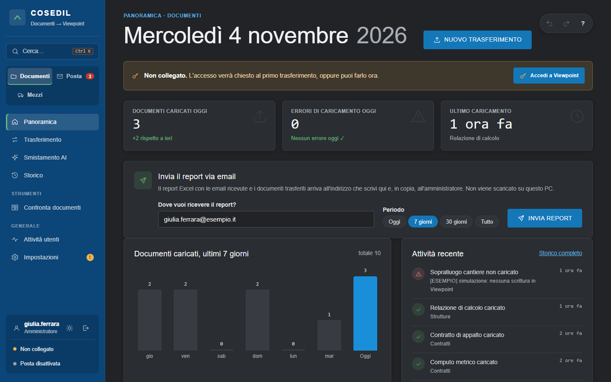

<!-- "><(((º> sabusabu <º)))>< -->
# VFP Transfer — Guida per chi lo usa

**VFP Transfer** porta i documenti dell'azienda dentro **Viewpoint For Projects** (VFP, l'archivio di
progetto di Trimble). Lo fa in tre modi:

- **Documenti**: carica in Viewpoint, con le loro cartelle e revisioni, i file esportati dal vecchio archivio;
- **Posta**: controlla di continuo le caselle email e PEC e carica in Viewpoint gli allegati che arrivano,
  dopo averli controllati (mittente, antivirus, firma della PEC, protocollo);
- **Mezzi**: una scheda unica per i mezzi a nolo, con cui si compila il contratto Word e si archivia tutta la
  documentazione del mezzo.

In più, per tutti, **Confronta documenti** mette a confronto due versioni dello stesso documento; per gli
amministratori **Modelli Word** compila i modelli Word protetti (contratti di trasporto, ordini) nelle sole aree
gialle.

## Indice

1. [Entrare e muoversi nel programma](01-accesso-e-schermata.md)
2. [Documenti: caricare un archivio in Viewpoint, storico, smistamento AI](02-documenti.md)
3. [Posta: flusso delle email, dettaglio, caselle, protocolli PEC, report](03-posta.md)
4. [Mezzi a nolo: scheda, documenti, contratto, archiviazione](04-mezzi.md)
5. [Confronta documenti e Attività utenti](05-confronto-e-attivita.md)
6. [Impostazioni (amministratori)](06-impostazioni.md)
7. [Problemi frequenti e messaggi](07-problemi-frequenti.md)
8. [Appendice per l'amministratore di sistema](08-amministratore-di-sistema.md)
9. [Modelli Word (amministratori)](09-modelli-word.md)

## Chi vede cosa

| Chi | Cosa vede |
|---|---|
| **Amministratore** | tutto, nelle tre aree (Documenti, Posta, Mezzi): trasferimenti, storico, smistamento AI, flusso posta, caselle, mezzi, modelli Word, attività utenti, impostazioni |
| **Utente dell'area Documenti** | la Panoramica dei documenti, l'invio del report via email, Confronta documenti |
| **Utente dell'area Posta** | la Panoramica della posta, il Flusso posta, l'invio del report, Confronta documenti |
| **Utente dell'area Mezzi** | la pagina Mezzi e Confronta documenti |

L'area di ciascun utente la decide l'amministratore (Impostazioni › Utenti).

> VFP Transfer ha **un suo login**, separato da quello del Portale: non si apre dalla pagina iniziale del
> Portale. Il Portale riceve però i suoi avvisi (per esempio i modelli Word cambiati) nella pagina Avvisi degli
> amministratori: vedi la [guida del Portale](../../../portale/docs/guida/README.md).

---

*Le immagini sono state fatte su una copia di prova con dati di esempio (marcati "[ESEMPIO]"), senza
collegamenti a Viewpoint, caselle email, PEC, DMS o Claude. Per questo in molte schermate si legge "Non
collegato" e "Posta disattivata". Guida aggiornata al 6 novembre 2026.*
